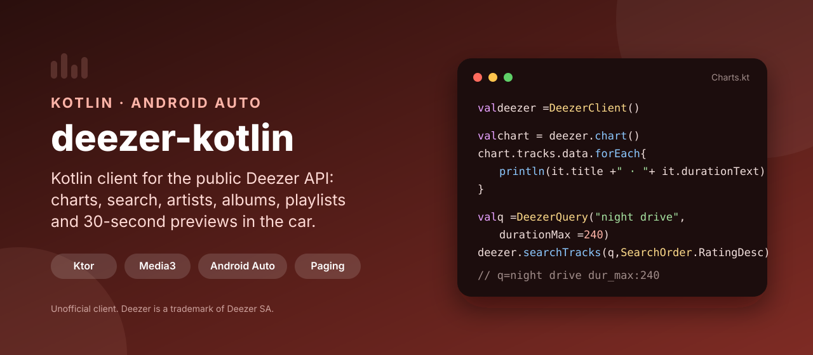
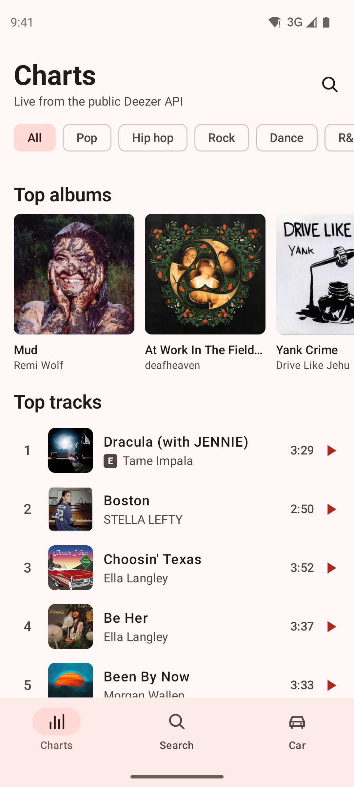
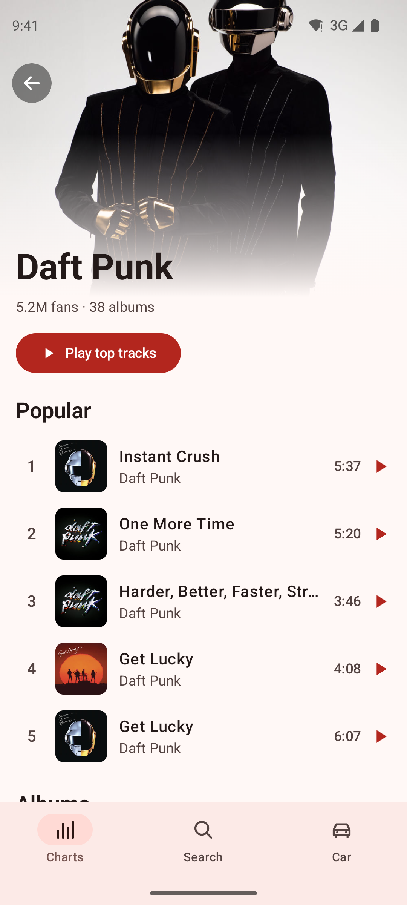
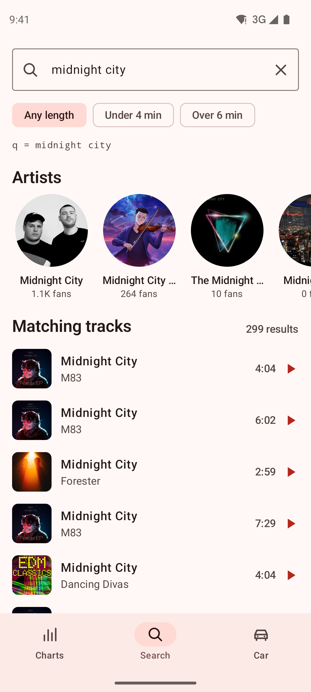
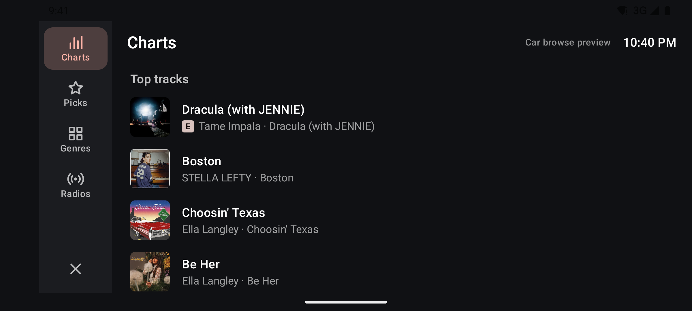

<p align="center">
  
</p>

<p align="center">
  <a href="https://github.com/halilozel1903/deezer-kotlin/actions/workflows/ci.yml"></a>
  <a href="https://jitpack.io/#halilozel1903/deezer-kotlin"></a>
  
  
  
  
  
  <a href="LICENSE"></a>
</p>

**deezer-kotlin** is a Kotlin client for the public [Deezer API](https://developers.deezer.com/api) with an Android Auto music browser: charts, search, artists, albums, playlists and 30-second previews.

- **`deezer`** is a pure Kotlin library on Ktor and kotlinx.serialization (JVM and Android). It covers every endpoint that needs no login: charts, search with Deezer's advanced query syntax, artists (top tracks, albums, related artists, radio), albums, tracks, playlists, genres, radios and editorial pages. It handles paging, Deezer's error object, the request quota (50 requests per 5 seconds, error code 4 is retried after a pause) and caching.
- **`deezer-media`** is a Media3 `MediaLibraryService` for Android Auto: four tabs (Charts, Picks, Genres, Radios), albums, playlists, artists and genres to browse, voice and text search, and preview playback with ExoPlayer.
- **`sample`** is Pocket Charts, a phone app on both modules, with an in-app preview of the car browse tree.

```kotlin
val deezer = DeezerClient()

val chart = deezer.chart()                                    // GET /chart/0
chart.tracks.data.forEach { println("${it.title} · ${it.artist?.name} · ${it.durationText}") }

val short = deezer.searchTracks(DeezerQuery("night drive", durationMax = 240), SearchOrder.RatingDesc)
val preview = short.data.firstOrNull()?.previewUrl            // a 30-second MP3
```

> **Unofficial client.** Deezer is a trademark of Deezer SA. This project is not affiliated with, endorsed by or sponsored by Deezer. Use the API under [Deezer's terms](https://developers.deezer.com/termsofuse); previews are 30-second clips meant for discovery.

## Screenshots

These are real screens: CI runs the sample on an Android emulator against the **live public Deezer API**, with cover art loaded by Coil from Deezer's CDN, and commits the result. Charts and search results are whatever Deezer returned on the day of the last run, so they change over time. The unit tests use JSON fixtures instead (see [Tests](#tests)); the screenshots never do.

| Charts | Artist | Search |
| :---: | :---: | :---: |
|  |  |  |

**Car browse preview:** the browse tree that `deezer-media` serves to Android Auto, drawn by the sample the way a car display lays it out (tabs on the side, group headers, rows). It is the same `DeezerBrowseTree` on live data, rendered by the app; it is not a capture of Android Auto itself.



## Features

- **Every public endpoint** as a suspend function, with typed models (`Track`, `Album`, `Artist`, `Playlist`, `Genre`, `Radio`, `Editorial`, `Chart`, `Podcast`, `User`).
- **Advanced search**: `DeezerQuery(text, artist, album, track, label, durationMin, durationMax, bpmMin, bpmMax)` builds Deezer's `artist:"…" dur_max:240` syntax, with quoting handled. `SearchOrder` and strict mode are supported.
- **Paging**: every list is a `DeezerPage` with `total`, `next` and `prev`; `nextIndex`, `nextPage()` and the lazy `pages { index, limit -> … }` flow (with ready-made flows such as `chartTrackPages`, `albumTrackPages` and `searchTrackPages`) follow Deezer's `index`/`limit` paging. `items()` flattens pages into items.
- **Errors**: Deezer sends errors as `{"error": {"type", "message", "code"}}` with HTTP 200. They become `DeezerException.NotFound` (code 800), `QuotaExceeded` (code 4), `Api` (any other code), `Http`, `Network` or `Decoding`.
- **Quota**: requests share a rate limiter (50 per 5 seconds, per IP); a quota error pauses the limiter and retries (`quotaRetries`, `quotaRetryDelayMillis`). Network errors and 5xx responses are retried with backoff.
- **Caching**: an in-memory LRU cache by default, `DeezerCache.disk(dir)` for files, combine them with `memory + disk`. Identical requests running at the same time share one call.
- **Images**: `DeezerImages.url(type, md5, sizePx)` for any size of cover or picture, and `pictureFor(sizePx)` on every model with pictures.
- **Android Auto** (`deezer-media`): content style hints (lists for tracks, grids for genres and picks), group titles, explicit flags, search, `content://` artwork through a bundled provider, and queues: playing an album, playlist, radio or artist queues its tracks with fresh preview urls.
- **Browse tree** (`DeezerBrowseTree`, in the pure Kotlin module): the whole media tree rebuilt from media ids such as `album/302127`, so you can reuse it for Wear OS, a TV app or your own UI.
- **Any engine**: Ktor CIO by default, or pass OkHttp, a ready `HttpClient` or a `MockEngine`. Explicit API mode, no Android dependency in `deezer`.

### Endpoints

| Area | Functions | Deezer endpoint |
| --- | --- | --- |
| Charts | `chart`, `chartTracks`, `chartAlbums`, `chartArtists`, `chartPlaylists`, `chartPodcasts`, `chartTrackPages` | `/chart/{genre}`, `/chart/{genre}/tracks` … |
| Search | `searchTracks`, `searchAlbums`, `searchArtists`, `searchPlaylists` (text or `DeezerQuery`), `searchTrackPages` | `/search/track`, `/search/album`, `/search/artist`, `/search/playlist` |
| Artists | `artist`, `artistTopTracks`, `artistAlbums`, `artistAlbumPages`, `relatedArtists`, `artistRadio` | `/artist/{id}`, `/top`, `/albums`, `/related`, `/radio` |
| Albums | `album`, `albumTracks`, `albumTrackPages` | `/album/{id}`, `/album/{id}/tracks` |
| Tracks | `track` | `/track/{id}` |
| Playlists | `playlist`, `playlistTracks`, `playlistTrackPages` | `/playlist/{id}`, `/playlist/{id}/tracks` |
| Genres | `genres`, `genre`, `genreArtists`, `genreRadios` | `/genre`, `/genre/{id}`, `/artists`, `/radios` |
| Radios | `radios`, `radio`, `radioTracks`, `radioGenres`, `topRadios` | `/radio`, `/radio/{id}`, `/radio/{id}/tracks`, `/radio/genres`, `/radio/top` |
| Editorial | `editorials`, `editorial`, `editorialCharts`, `editorialReleases`, `editorialSelection` | `/editorial`, `/editorial/{id}`, `/charts`, `/releases`, `/selection` |
| Any url | `fetch`, `nextPage`, `pages` | `next` links, `tracklist` urls |

## Installation

Add JitPack to `settings.gradle.kts`:

```kotlin
dependencyResolutionManagement {
    repositories {
        google()
        mavenCentral()
        maven("https://jitpack.io")
    }
}
```

Then the modules you need:

```kotlin
dependencies {
    // The API client (pure Kotlin, JVM and Android):
    implementation("com.github.halilozel1903.deezer-kotlin:deezer:1.0.0")

    // The Android Auto media service (includes the client):
    implementation("com.github.halilozel1903.deezer-kotlin:deezer-media:1.0.0")

    // Optional: run the client on OkHttp instead of Ktor's CIO engine.
    implementation("io.ktor:ktor-client-okhttp:3.6.0")
}
```

> The build is also set up for Maven Central (`io.github.halilozel1903:deezer`) via the vanniktech publish plugin.

## Usage

### The client

```kotlin
val deezer = DeezerClient {
    engine = OkHttp.create()                                       // optional; CIO by default
    cache = DeezerCache.memory() + DeezerCache.disk(File(cacheDir, "deezer"))
}

// Charts, overall (0) or for a genre
val chart = deezer.chart()
val popTracks = deezer.chartTracks(genreId = 132, limit = 50).data

// An artist page
val artist = deezer.artist(27)
val top = deezer.artistTopTracks(27, limit = 5).data
val albums = deezer.artistAlbums(27).data
val related = deezer.relatedArtists(27).data

// Advanced search
val tracks = deezer.searchTracks(DeezerQuery(artist = "Daft Punk", track = "One More Time")).data
val calm = deezer.searchTracks(DeezerQuery("piano", bpmMax = 90), SearchOrder.RatingDesc)

// Every track of a playlist, page by page
val all = deezer.playlistTrackPages(playlistId, pageSize = 100).items().toList()

deezer.close()
```

### Errors and the quota

```kotlin
try {
    deezer.album(id)
} catch (e: DeezerException.NotFound) {
    // Deezer answered {"error":{"type":"DataException","message":"no data","code":800}}
} catch (e: DeezerException.QuotaExceeded) {
    // Still over the quota after quotaRetries retries (code 4)
} catch (e: DeezerException) {
    // Network, HTTP, decoding or another Deezer error; e.error has Deezer's error object when there is one
}
```

The quota is per IP address, so every `DeezerClient` shares `DeezerRateLimiter.shared` by default. Tune the retries in the builder:

```kotlin
val deezer = DeezerClient {
    retries = 2                    // network errors and 5xx
    quotaRetries = 3               // error code 4
    quotaRetryDelayMillis = 5_000
}
```

### Android Auto

Declare the service (or your subclass of it) and the car meta-data in your app manifest. The library's manifest adds the permissions and the artwork provider.

```xml
<application>
    <meta-data
        android:name="com.google.android.gms.car.application"
        android:resource="@xml/deezer_automotive_app_desc" />

    <service
        android:name="io.github.halilozel1903.deezer.media.DeezerMediaLibraryService"
        android:exported="true"
        android:foregroundServiceType="mediaPlayback">
        <intent-filter>
            <action android:name="androidx.media3.session.MediaLibraryService" />
            <action android:name="android.media.browse.MediaBrowserService" />
        </intent-filter>
    </service>
</application>
```

That's the whole setup: Android Auto shows the app with Charts, Picks, Genres and Radios tabs. Subclass the service to change the client, the tree, the player or the session callback:

```kotlin
class MusicService : DeezerMediaLibraryService() {
    override fun createClient() = DeezerClient { engine = OkHttp.create() }

    override fun createBrowseTree(client: DeezerClient) = DeezerBrowseTree(
        client,
        strings = BrowseStrings(charts = "Top 100", radios = "Mixes"),
        groupSize = 6,
    )
}
```

| Media id | Children |
| --- | --- |
| `root` | `charts`, `picks`, `genres`, `radios` |
| `charts`, `genre/{id}` | Top tracks, Top albums, Top playlists and Top artists (groups) |
| `charts/tracks` | every top track, paged |
| `picks` | Editor's picks and New releases (groups) |
| `genres` | every genre (grid) |
| `radios` | the top radios (playable) |
| `album/{id}`, `playlist/{id}`, `radio/{id}` | tracks |
| `artist/{id}` | Popular tracks and Albums (groups) |

Tracks without a preview are left out. Android Auto only loads artwork from `content://` urls, so `DeezerArtworkProvider` (authority `<applicationId>.deezer.artwork`) downloads covers from Deezer's CDN into the cache and serves them; it refuses any host but `*.dzcdn.net` and `api.deezer.com`. Test in the car with the [Desktop Head Unit](https://developer.android.com/training/cars/testing/dhu).

From your own UI, connect a `MediaController` to the service and send media ids; the service resolves them to fresh preview urls (they expire):

```kotlin
controller.setMediaItems(listOf(MediaItem.Builder().setMediaId("album/302127").build()))
controller.prepare()
controller.play()
```

## Tests

`./gradlew :deezer:test` runs the client against a Ktor `MockEngine` that serves JSON fixtures in Deezer's response format from `deezer/src/test/resources/fixtures`. The fixtures are made up for the tests (names, ids and numbers are not real Deezer data). They cover every endpoint, the advanced query syntax, paging through `next` links, the error object, quota error 4 with retries, network retries, caching and the browse tree. `FixtureTransport` (in the library) maps API urls to fixture files if you want the same setup in your own tests.

## Sample app

The `sample` module is Pocket Charts. Everything it shows comes from the live public Deezer API:

- **Charts**: top albums, tracks and artists, overall or for a genre.
- **Artist**: picture, fans, popular tracks, albums and related artists.
- **Search**: artists and tracks, with length filters sent as `dur_min`/`dur_max`; the screen shows the `q` string the client built.
- **Car**: the browse tree of the car service, laid out like a car display.

Tap a track to play its 30-second preview. The app plays through `SampleMediaService` (a `DeezerMediaLibraryService`), the same session Android Auto connects to.

Swipes and taps can't be timed reliably through adb, so the sample opens a fixed screen from an intent extra (used by `scripts/screenshots.sh`):

```bash
./gradlew :sample:installDebug
adb shell am start -n io.github.halilozel1903.deezer.sample/.MainActivity --es scene artist
```

`scene` is one of `charts`, `artist` (Daft Punk), `search` ("night drive", under 4 minutes) or `car`. In a scene the app retries the network a few times and then shows an error; it never falls back to stored data. The script waits for each screen's section header ("Top tracks", "Popular", "Matching tracks"), which only appears once Deezer has answered, so a failed load fails the CI step instead of producing a screenshot.

## Project structure

| Module | What it is |
| --- | --- |
| `deezer` | Pure Kotlin client: `DeezerClient`, models, `DeezerQuery`, paging, cache, rate limiter, `DeezerBrowseTree`. Published as `deezer` |
| `deezer-media` | Android: `DeezerMediaLibraryService`, `DeezerLibraryCallback`, `DeezerMediaItems`, `DeezerArtworkProvider`. Published as `deezer-media` |
| `sample` | Pocket Charts, a Compose phone app with a car browse preview and screenshot scenes |

## Tech stack

Kotlin 2.4 · AGP 9.4 with built-in Kotlin · Gradle 9.6 · Ktor 3.6 · kotlinx.serialization · kotlinx.coroutines · Media3 1.8 (session, ExoPlayer) · Jetpack Compose (BOM 2026.09) · Material 3 · Coil 3 · JUnit · GitHub Actions with Android emulators

## License

MIT. See [LICENSE](LICENSE).

Deezer is a trademark of Deezer SA. deezer-kotlin is an independent, unofficial project.
